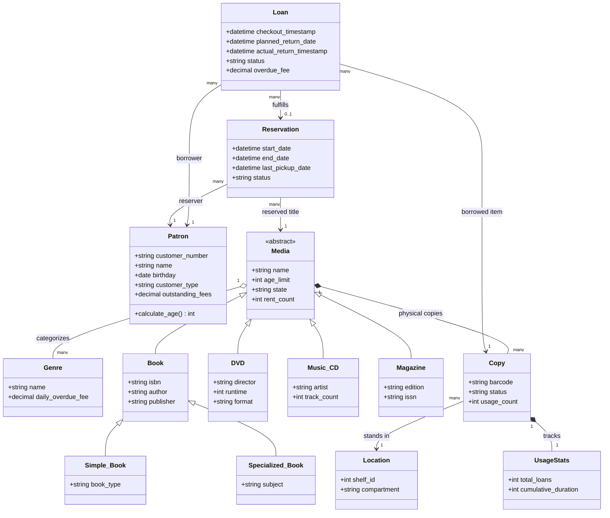

# ITS-B-SWD-Library: LiBros Bibliothekssystem

[](https://www.python.org/)
[](https://www.djangoproject.com/)
[]()
[]()
[](https://www.fh-salzburg.ac.at/)

**LiBros** ist ein modernes, serverzentriertes Bibliotheks-Management-System, entwickelt im Rahmen des Moduls **Software Design - Lab (FH Salzburg GmbH)**.  
Das System digitalisiert Kernprozesse öffentlicher Bibliotheken: **Medienausleihe**, **automatisierte Rückgabe an Hardware-Stationen** und **vorausplanende Reservierungen**, unter strikter Einhaltung von Geschäftsregeln, FSK-Schutz, Leihfristen, Gebührenordnungen und Transaktionssicherheit (Concurrency Control).

---

## 📑 Inhaltsverzeichnis

1. [Team & Aufgabenverteilung](#-team--aufgabenverteilung)
2. [Systemarchitektur & Schichtenmodell](#-systemarchitektur--schichtenmodell)
3. [Die 3 Use Cases im Detail](#-die-3-use-cases-im-detail)
   - [Use Case 1: Medium ausleihen (Loan)](#-use-case-1-medium-ausleihen-loan)
   - [Use Case 2: Medium zurückgeben (Return)](#-use-case-2-medium-zurückgeben-return)
   - [Use Case 3: Medium reservieren (Reservation)](#-use-case-3-medium-reservieren-reservation)
4. [Datenmodell & Klassenhierarchie](#-datenmodell--klassenhierarchie)
5. [REST-API Referenz](#-rest-api-referenz)
6. [Installation & Schnelleinstieg](#-installation--schnelleinstieg)
7. [SQL-Datenbankanbindung](#-sql-datenbankanbindung)
8. [Qualitätssicherung & Test-Suite (27 Tests)](#-qualitätssicherung--test-suite)
9. [Projekt- & Verzeichnisstruktur](#-projekt--verzeichnisstruktur)

---

## 👥 Team & Aufgabenverteilung

Gemäß den Projektanforderungen für ein Dreier-Team (**Team 3**) verantwortet jedes Mitglied die End-to-End-Umsetzung eines Use Cases über alle Schichten:

| Rolle | Teammitglied | Verantwortung & Kernbereich |
| :--- | :--- | :--- |
| **1. Autor** | **Alexander Graf** | Base-Setup & **Use Case 1: Medium ausleihen (Loan)**<br>*(Web-App / Kiosk, FSK-Validierung, automatische Exemplarzuweisung, Leihfrist-Berechnung)* |
| **2. Autor** | **David Leberbauer** | **Use Case 2: Medium zurückgeben (Return)**<br>*(Rückgabestation Hardware-Simulation, 2-Phasen-Rücknahmeprozess, Überziehungsgebühren, Abnutzungsschwelle)* |
| **3. Autor** | **Marcel Kitzmantel** | **Use Case 3: Medium reservieren (Reservation) & SQL-Datenbankanbindung**<br>*(Kapazitätsprüfung im Zeitfenster, Abholfristen, Stornierung & Expiration, DB-Konfiguration)* |

---

## 🏛️ Systemarchitektur & Schichtenmodell

Das System folgt einer strikten **Client-Server-Architektur mit Schichtenmodell** gemäß dem Architekturentwurf in *SWD-LiBros.pdf (Kapitel 3)*:

```
┌────────────────────────────────────────────────────────────────────────┐
│                   Dezentrale Clients (Presentation)                    │
│      • Patron Web-App / Kiosk          • Return Station Simulator      │
└───────────────────────────────────┬────────────────────────────────────┘
                                    │ IPatronWebAPI / IReturnStationAPI
┌───────────────────────────────────▼────────────────────────────────────┐
│                       API & Controller Layer                           │
│      • Web Views (Django)              • REST API Endpoints (DRF)      │
└───────────────────────────────────┬────────────────────────────────────┘
                                    │ ILoanService / IReturnService / IReservationService
┌───────────────────────────────────▼────────────────────────────────────┐
│                     Use-Case Service Layer                             │
│   • LoanService (UC-01)   • ReturnService (UC-02)   • ResService (UC-03)│
└───────────────────┬────────────────────────────────┬───────────────────┘
                    │                                │
┌───────────────────▼──────────────┐   ┌─────────────▼───────────────────┐
│     Domain Rules & Policies      │   │    Concurrency & Locking        │
│   • RulePolicyEngine             │   │    • ConcurrencyLockManager     │
│     - FSK-Altersprüfung          │   │      - select_for_update()      │
│     - Leihfristen (4 vs 6 Wochen)│   │      - Doppelzuweisungsschutz   │
│     - Überziehungsgebühren       │   │      - Überbuchungsschutz       │
│     - Wear/Usage Threshold (50)  │   │                                 │
└───────────────────┬──────────────┘   └─────────────┬───────────────────┘
                    │                                │
┌───────────────────▼────────────────────────────────▼───────────────────┐
│                   Data Access / Persistence Layer                      │
│   • MasterDataRepository             • TransactionRepository           │
│     (Media, Copy, Location, Patron)    (Loan, Reservation, UsageStats) │
└───────────────────────────────────┬────────────────────────────────────┘
                                    │ Django ORM (SQL)
┌───────────────────────────────────▼────────────────────────────────────┐
│                    Zentrale SQL-Datenbank                              │
│      • SQLite (Default)   • PostgreSQL   • MySQL                       │
└────────────────────────────────────────────────────────────────────────┘
```

### Komponenten-Schnittstellen (Interfaces):
- `IPatronWebAPI`: HTTP/Web-Schnittstelle für Katalog, Checkout und Reservierung.
- `IReturnStationAPI`: REST-Schnittstelle für die dezentralen Rückgabestationen.
- `ILoanService`, `IReturnService`, `IReservationService`: Entkoppelte Geschäftslogik.
- `IPolicyValidation`, `IFeeAndThreshold`: Zentrale Validierung und Tarifberechnung.
- `IConcurrencyLock`: Sperr- und Synchronisationsmechanismen im Mehrbenutzerbetrieb.
- `IMasterDataAccess`, `ITransactionAccess`: Abstrahierter Datenzugriff ohne Leckage von DB-Details in die Services.

---

## 🔍 Die 3 Use Cases im Detail

### 📖 Use Case 1: Medium ausleihen (Loan)
*Verantwortlich: Alexander Graf*

- **Trigger:** Ein Kunde wählt an der Web-Applikation oder am Kiosk-Terminal ein gewünschtes Medium (Titel) aus und bestätigt die Ausleihe.
- **Geschäftsregeln:**
  - **Auswahl auf Titelebene:** Der Kunde wählt das Werk (`Media`), das System ermittelt und sperrt automatisch ein physisch verfügbares Exemplar (`Copy`).
  - **FSK-Altersfreigabe:** Das Geburtsdatum des Kunden wird mit `media.age_limit` abgeglichen. Minderjährige dürfen keine Medien mit FSK 18 ausleihen (`FSKViolationException`).
  - **Leihfrist-Berechnung:**
    - Standard: **4 Wochen (28 Tage)**.
    - Studierende (`Patron.CUSTOMER_TYPE_STUDENT`) erhalten für Fachbücher (`Specialized_Book`): **bis zu 6 Wochen (42 Tage)**.
  - **Reservierungs-Einlösung:** Besitzt der Kunde eine aktive Vormerkung für den Titel, wird diese im `Loan` referenziert und auf `fulfilled` gesetzt.
  - **Concurrency Control:** Schutz vor Doppelzuweisung des letzten Exemplars via `select_for_update()`.
- **Ausgabe:** Bestätigung inkl. Fälligkeitsdatum und genauer physischer Standortanzeige (**Regal-ID und Fach**).

---

### 📟 Use Case 2: Medium zurückgeben (Return)
*Verantwortlich: David Leberbauer*

- **Trigger:** Ein Kunde scannt den Barcode eines Exemplars an einer automatisierten Rückgabestation.
- **Hardware-Simulation (Return Station):**
  - Authentische Bedienoberfläche mit LCD-Statusbildschirm, Farbcodes (READY, BUSY, DENIED) und servogesteuertem Einwurfschacht.
- **Zweistufiger Prozess (Hardware & Server):**
  1. **Annahmeanfrage (`POST /returns/api/check/`):** Station prüft, ob das Exemplar zur Bibliothek gehört und ein offener `Loan` existiert. Bei ungültigem Barcode oder nicht ausgeliehenem Medium wird die Annahme sofort verweigert (Schacht bleibt verriegelt, keine Datenänderung).
  2. **Physische Annahme & Bestätigung (`POST /returns/api/confirm/`):** Nach dem Einwurf meldet die Station den Vollzug. Der `Loan` wird mit `actual_return_timestamp` geschlossen.
- **Überziehungsgebühren:**
  - Liegt das Rückgabedatum nach dem `planned_return_date`, werden die Überziehungstage ermittelt.
  - Der Tagessatz richtet sich nach dem **höchsten Gebührentarif** aller zugeordneten Genres des Mediums.
  - Die Versäumnisgebühr wird automatisch im `Loan` erfasst und dem Kundenkonto (`outstanding_fees`) belastet.
- **Nutzungsstatistik & Abnutzungsschwelle (Wear Threshold):**
  - `total_loans + 1`, `cumulative_duration += Tage`, `usage_count + 1`.
  - Erreicht ein Exemplar den Schwellenwert (**50 Ausleihen**), wechselt sein Status auf **`withdrawn/replacement`** (Aussonderung für Ersatzbeschaffung), andernfalls auf **`available`**.
- **Reservierungsbenachrichtigung:** Wartet ein anderer Kunde auf diesen Titel, wird die Station informiert.

---

### 📅 Use Case 3: Medium reservieren (Reservation)
*Verantwortlich: Marcel Kitzmantel*

- **Trigger:** Ein Kunde reserviert ein Medium (auf Titelebene) für ein zukünftiges Zeitintervall (`start_date` bis `end_date`).
- **Geschäftsregeln:**
  - **Intervallvalidierung:** Startdatum muss in der Zukunft liegen und vor dem Enddatum sein.
  - **FSK-Prüfung:** Altersfreigabe muss vor dem Vormerken erfüllt sein.
  - **Rechnerische Kapazitätsprüfung:**
    $$\text{Verfügbare Kapazität} = \text{Gesamtexemplare} - (\text{aktive Ausleihen} + \text{überlappende Reservierungen})$$
    Übersteigt die Nachfrage im Intervall die Gesamtzahl der betriebsbereiten Exemplare, wird die Anfrage abgelehnt (`CapacityExceededException`).
  - **Concurrency Control:** Serialisierung der Reservierungsanfragen verhindert überlappende Doppelüberbuchungen.
  - **Abholfrist (Last Pickup Date):** Festgelegt auf `start_date + 3 Tage`.
- **Lifecycle bis zur Abholung:**
  - **Abholung:** Geht nahtlos in UC-01 über.
  - **Stornierung:** Kunde kann Vormerkung stornieren; Kapazität wird sofort freigegeben.
  - **Automatischer Ablauf (`expired`):** Verstreicht die Abholfrist ohne Abholung, verfällt die Reservierung automatisch und gibt den Platz frei.

---

## 🗄️ Datenmodell & Klassenhierarchie

Das Datenmodell implementiert die Trennung von **Stammdaten (Master Data)** und **Transaktionsdaten (Transactional Data)**:



---

## 🌐 REST-API Referenz

Alle Use Cases stellen REST-Endpunkte für dezentrale Clients, Kioske und Hardware-Terminals bereit:

| Methode | Pfad | Beschreibung | Payload / Query |
| :--- | :--- | :--- | :--- |
| **POST** | `/loans/api/checkout/` | Führt Ausleihe aus | `{"patron_id": 1, "media_id": 2, "reservation_id": 3}` |
| **POST** | `/returns/api/check/` | Station prüft Annahmeberechtigung | `{"barcode": "BARCODE-BOOK-001"}` |
| **POST** | `/returns/api/confirm/` | Station bestätigt physischen Einwurf | `{"barcode": "BARCODE-BOOK-001"}` |
| **POST** | `/reservations/api/create/` | Legt Vormerkung an | `{"patron_id": 1, "media_id": 2, "start_date": "2026-12-01", "end_date": "2026-12-15"}` |
| **POST** | `/reservations/api/cancel/` | Storniert Vormerkung | `{"reservation_id": 1}` |
| **GET** | `/reservations/api/check/` | Fragt freie Kapazität ab | `?media_id=1&start_date=2026-12-01&end_date=2026-12-15` |

---

## 🚀 Installation & Schnelleinstieg

### 1. Schnelleinstieg mit `just` (Empfohlen)

Das Projekt enthält ein vorkonfiguriertes [`Justfile`](file:///Users/alex/Github/ITS-B-SWD-Library/Justfile):

```bash
# 1. Abhängigkeiten synchronisieren (erstellt automatisch .venv)
just install

# 2. Datenbank-Schema initialisieren
just migrate

# 3. Test- und Demodaten laden (Kunden, Medien, Fächer, Barcodes)
just seed

# 4. Automatisierte Tests ausführen (27 Tests)
just test

# 5. Entwicklungsserver starten
just run
```
Der Server läuft anschließend unter [http://127.0.0.1:8000/](http://127.0.0.1:8000/).

---

### 2. Ausführung mit `uv`

```bash
uv sync
uv run python manage.py migrate
uv run python manage.py seed_data
uv run python manage.py test
uv run python manage.py runserver
```

---

### 3. Direkte Ausführung im Virtual Environment

```bash
.venv/bin/python manage.py migrate
.venv/bin/python manage.py seed_data
.venv/bin/python manage.py test
.venv/bin/python manage.py runserver
```

---

## 🗄️ SQL-Datenbankanbindung

Das System unterstützt standardmäßig die relationale Datenbank **SQLite** und kann produktiv auf **PostgreSQL** oder **MySQL** umgeschaltet werden:

1. **Standard (SQLite):** Vorkonfiguriert in `db.sqlite3`. Funktioniert lokal ohne zusätzliche Server-Dienste.
2. **PostgreSQL / MySQL:** Kopiere `.env.example` nach `.env`:
   ```ini
   DB_ENGINE=postgresql
   DB_NAME=libros_db
   DB_USER=libros_user
   DB_PASSWORD=secret_password
   DB_HOST=localhost
   DB_PORT=5432
   ```
   PostgreSQL-Treiber installieren:
   ```bash
   just install-postgres
   # bzw.:
   uv sync --extra postgres
   ```

---

## 🧪 Qualitätssicherung & Test-Suite

Das Projekt umfasst **27 automatisierte Unit- und Integrationstests**, die alle geforderten Grenz- und Fehlerfälle abdecken (Arrange-Act-Assert Muster, Test-Isolation):

| Bereich | Datei | Tests | Abgedeckte Prüfpfade |
| :--- | :--- | :---: | :--- |
| **UC-01 (Loan)** | [`apps/loans/tests.py`](file:///Users/alex/Github/ITS-B-SWD-Library/apps/loans/tests.py) | **10** | • Erfolgreiche Ausleihe & Exemplarzuweisung<br>• FSK-Ablehnung (Jugendlicher vs. FSK 18 DVD)<br>• Ablehnung bei fehlender Verfügbarkeit<br>• Standard-Leihfrist (28 Tage)<br>• Studenten-Leihfrist für Fachbücher (42 Tage)<br>• Reservierungseinlösung<br>• **Multi-Thread Concurrency:** Schutz vor Doppelzuweisung des letzten Exemplars<br>• Web- & REST-API-Controller |
| **UC-02 (Return)** | [`apps/returns/tests.py`](file:///Users/alex/Github/ITS-B-SWD-Library/apps/returns/tests.py) | **8** | • Fristgerechte Rückgabe (0 € Gebühren)<br>• Überziehungsgebühr (Berechnung mit höchstem Genre-Tarif & Buchung auf Kundenkonto)<br>• Nutzungsstatistik (`total_loans + 1`, Dauer)<br>• **Wear Threshold:** Statusübergang auf `withdrawn/replacement` ab 50 Ausleihen<br>• Ablehnung bei unbekanntem Barcode<br>• Ablehnung bei nicht ausgeliehenem Medium<br>• REST-Endpoints (Annahmeanfrage & Bestätigung) |
| **UC-03 (Reservation)** | [`apps/reservations/tests.py`](file:///Users/alex/Github/ITS-B-SWD-Library/apps/reservations/tests.py) | **9** | • Erfolgreiche Reservierung & Abholfrist (`start + 3 Tage`)<br>• Ablehnung bei Kapazitätsüberschreitung im Zeitfenster<br>• FSK-Verstoß-Ablehnung<br>• Ablehnung bei ungültigem Intervall (Vergangenheit, Start >= Ende)<br>• Stornierung gibt Kapazität sofort frei<br>• Automatischer Ablauf (`expired`) bei Fristüberschreitung<br>• **Multi-Thread Concurrency:** Schutz vor konkurrierender Überbuchung<br>• REST-Endpoints |
| **Gesamt** | | **27** | **100% Erfolgsquote in ~0.1 Sekunden** |

### Tests ausführen:
```bash
# Alle Tests ausführen
just test

# Einzelne App testen
just test-app loans
just test-app returns
just test-app reservations
```

---

## 📂 Projekt- & Verzeichnisstruktur

```text
ITS-B-SWD-Library/
├── pyproject.toml                     # Projektkonfiguration & Dependencies (uv)
├── Justfile                           # Task-Runner Workflows (just)
├── requirements.txt                   # Fallback-Pip-Requirements
├── .env.example                       # Umgebungsvariablen-Vorlage für Datenbank
├── manage.py                          # Django Management CLI
├── db.sqlite3                         # Relationale SQL-Datenbank
│
├── libros_project/                    # Zentrale Django-Konfiguration
│   ├── settings.py                    # Multi-DB-Settings, Apps, Zeitzonen
│   ├── urls.py                        # Root URL-Routing
│   ├── wsgi.py / asgi.py
│
├── apps/
│   ├── core/                          # Stammdaten & Persistence Layer
│   │   ├── models.py                  # Vollständiges relationales Klassendiagramm
│   │   ├── admin.py                   # Django-Admin-Verwaltung
│   │   ├── policies.py                # RulePolicyEngine (FSK, Fristen, Gebühren, Wear)
│   │   ├── concurrency.py             # ConcurrencyLockManager (Transaktionssperren)
│   │   ├── repositories.py            # MasterData & Transaction Repositories
│   │   └── management/commands/
│   │       └── seed_data.py           # Demo- und Testdaten-Generator
│   │
│   ├── loans/                         # USE CASE 1: Medium ausleihen (Alex)
│   │   ├── loan_service.py            # ILoanService Geschäftslogik
│   │   ├── views.py                   # Web- & Kiosk-Controller, REST-API
│   │   ├── forms.py                   # Eingabevalidierung
│   │   ├── urls.py                    # Routing (/loans/)
│   │   ├── tests.py                   # 10 Unit- & Concurrency-Tests
│   │   └── templates/loans/
│   │       └── loan_form.html         # Kiosk-Checkout & Katalogansicht
│   │
│   ├── returns/                       # USE CASE 2: Medium zurückgeben (David)
│   │   ├── return_service.py          # IReturnService Geschäftslogik
│   │   ├── views.py                   # Return Station Controller & 2-Phasen REST API
│   │   ├── forms.py                   # Barcode-Scan-Formular
│   │   ├── urls.py                    # Routing (/returns/)
│   │   ├── tests.py                   # 8 Unit-Tests & Hardwaresimulation
│   │   └── templates/returns/
│   │       └── return_station.html    # Rückgabestation Hardware-Simulation
│   │
│   └── reservations/                  # USE CASE 3: Medium reservieren (Marcel)
│       ├── reservation_service.py     # IReservationService Geschäftslogik
│       ├── views.py                   # Reservierungs-Controller & REST API
│       ├── forms.py                   # Intervallvalidierung
│       ├── urls.py                    # Routing (/reservations/)
│       ├── tests.py                   # 9 Unit- & Concurrency-Tests
│       └── templates/reservations/
│           └── reservation_form.html  # Vormerkungs- & Stornierungs-UI
│
└── templates/                         # Globale Web-Templates
    ├── base.html                      # Bootstrap 5 Layout mit Navigation
    └── index.html                     # Zentrale Portalseite / Dashboard
```

---

## 🖥️ Benutzeroberflächen & Navigation

Nach dem Starten des Entwicklungsservers stehen folgende Oberflächen bereit:

- **Startseite / Dashboard:** [http://127.0.0.1:8000/](http://127.0.0.1:8000/) – Direkter Einstieg zu allen 3 Use Cases.
- **UC-01 Ausleihe (Kiosk / Web):** [http://127.0.0.1:8000/loans/](http://127.0.0.1:8000/loans/) – Medienbestand durchsuchen, Verfügbarkeit prüfen, Medium ausleihen & Regalstandort abrufen.
- **UC-02 Rückgabestation:** [http://127.0.0.1:8000/returns/](http://127.0.0.1:8000/returns/) – Interaktive Hardware-Simulation des Rückgabe-Terminals (mit Schnellauswahl bestehender Ausleihen und Fehlerfall-Barcodes).
- **UC-03 Reservierungs-Manager:** [http://127.0.0.1:8000/reservations/](http://127.0.0.1:8000/reservations/) – Vormerkung für künftige Intervalle, Abholfristen einsehen und Reservierungen stornieren.
- **Django Admin (Stammdatenverwaltung):** [http://127.0.0.1:8000/admin/](http://127.0.0.1:8000/admin/) – Verwaltung von Genres, Standorten, Kunden, Medien und Transaktionen.
